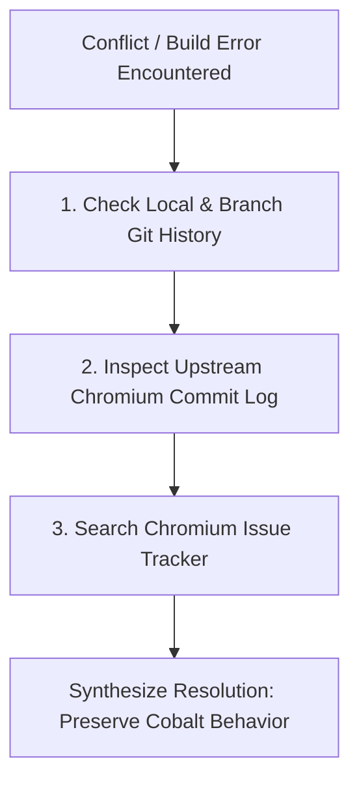

# Cobalt Chromium Rebase & Conflict Resolution Skill

When rebasing Cobalt onto a new Chromium milestone (e.g., M138 -> M139) or resolving autoroll conflicts, use this skill to understand the root cause of conflicts, and preserve Cobalt's existing behavior.

---

## 1. Pipeline Iteration & Retry Budget Guidelines

These budgets apply to every roll. They were calibrated on the M139 rebase (56 merge conflicts resolved, ~50 breaking API/linker issues fixed, 62 `autoninja` invocations across Desktop Linux and Android):

| Pipeline Phase | Recommended Retry / Iteration Budget | Rationale & Progress Tracking |
| :--- | :---: | :--- |
| **API / Network Glitches** | **5 attempts** | Exponential backoff (3s, 6s, 9s, 12s, 15s) for transient HTTP 429 rate limits and network timeouts. |
| **Conflict File Splicing** | **5 attempts** | Syntax repair attempts with `ast.parse()` (for `DEPS`) or compiler verification. |
| **`gclient sync -D` Self-Healing** | **10 attempts** | Resolves submodule index drift (e.g. `fuzztest`), obsolete directory purges, and `DEPS` revision pins. |
| **`autoninja` Target Build (Linux)** | **60 iterations** | Fixes multi-stage breaking C++ API migrations, GN check rules, header splits, and component visibility across `content_shell` and `cobalt`. |
| **`autoninja` Target Build (Android)** | **20 iterations** | Fixes Android JNI delegates, Java templates (`StarboardFeatures.java.tmpl`), and platform linker guards. |
| **Global Compiler Safety Guard** | **75 iterations total** | Stop early only if stuck on the **exact same** compiler diagnostic for >5 consecutive cycles without progress. |

---

## 2. Investigation Workflow (When Unsure How to Resolve)

If the resolution is ambiguous or involves complex API churn, **do not guess**. Follow this 3-step investigation process:



### Step 1: Check Local Git History
Understand how Cobalt previously modified the conflicted file:
* **View file history in Cobalt**:
  ```bash
  git log -n 5 -p -- <conflicted_file>
  ```
* **Inspect the conflicted commit metadata**:
  ```bash
  git log -1 --format="%H %B" HEAD
  ```
* **Check prior rebase/roll commits**:
  Identify how previous rolls added special Cobalt shims, build flags, or submodule mappings.
* **Learn from merged roll PRs**: in a merged bot roll PR, the trailing human commits after the bot's baseline commits show how similar conflicts and build breaks were fixed. Inspect them with `TOOL_READ_PR: <pr_number>` and `TOOL_PR_DIFF: <pr_number>`.

---

### Step 2: Inspect Upstream Chromium via Code Search & Gitiles
Determine why Chromium upstream modified the file, interface, or dependency:

1. **Chromium Code Search (source.chromium.org)**:
   * **Symbol Search**: Find class definitions, callers, and new method signatures:
     `https://source.chromium.org/chromium/chromium/src/+/main:?q=symbol:<SymbolName>`
   * **Header Moves & Splits**: Locate where deleted/moved headers migrated:
     `https://source.chromium.org/chromium/chromium/src/+/main:?q=file:<path>+"<keyword>"`
   * **Milestone-Scoped Search**: Inspect exact milestone implementations:
     `https://source.chromium.org/chromium/chromium/src/+/refs/tags/139.0.7244.0:?q=class:<ClassName>`

2. **Chromium Gitiles (chromium.googlesource.com)**:
   * **View Exact Commit Diff**: Extract upstream commit SHA from commit message:
     `https://chromium.googlesource.com/chromium/src/+/<upstream_sha>`
   * **View File History**: Trace all changes to an upstream source file:
     `https://chromium.googlesource.com/chromium/src/+log/main/<relative_filepath>`
   * **Raw File at Specific Tag**: View clean upstream file without conflict markers:
     `https://chromium.googlesource.com/chromium/src/+/refs/tags/139.0.7244.0/<relative_filepath>`

3. **Local Git Exploration**:
   ```bash
   git show <upstream_sha>
   git log -n 5 -p origin/main -- <relative_filepath>
   ```

4. **Pure Upstream Roll Commit (Commit #3 Inspection)**:
   * In every Cobalt autoroll PR, **Commit #3 (e.g., `Update to 140.7298.` or `Update to 140.7339.`)** contains the **pure upstream Chromium changes**.
   * Use this commit to see the exact changes upstream Chromium authors introduced before Cobalt conflicts were introduced:
     * **Tool Command**: `TOOL_UPSTREAM_DIFF: <filepath>` (extracts pure upstream changes for that file)
     * **Git CLI**: `git show $(git log -n20 --grep="Update to 14" --format=%H | grep -v CONFLICTED | head -n1) -- <filepath>`

---

### Step 3: Search Chromium's Public Issue Tracker (issues.chromium.org)
When upstream changes deprecate APIs or remove interfaces:
* **Extract Bug IDs**: Look for `Bug: <id>` or `Fixed: chromium:<id>` in the commit message.
* **Query Issue Tracker**:
  * Navigate to: `https://issues.chromium.org/issues/<id>`
  * Search keywords: `https://issues.chromium.org/issues?q=<symbol_or_error_message>`
* **Look for**:
  * Intent-to-Ship / Intent-to-Remove notices.
  * Design documents and API migration guides.
  * Related Chromium CLs providing replacement patterns.

---

## 3. Core Behavior Preservation Principles

> [!IMPORTANT]
> **Preserve Cobalt Behavior**: If an upstream Chromium API changed or runtime behavior shifted, **always strive to preserve current Cobalt behavior** rather than silently accepting upstream behavioral regressions.

1. **Preserve Cobalt Semantics with Shims / Macro Guards**:
   * If a method was removed or altered in Chromium, adapt the call site or introduce a compatibility wrapper to retain Cobalt's runtime semantics.
   * Preserve Cobalt macro blocks:
     * `#if BUILDFLAG(USE_STARBOARD_MEDIA)`
     * `#if BUILDFLAG(IS_COBALT)`
     * Starboard platform bridges and media decoders.
   * Preserve custom Cobalt variables in `DEPS` (`checkout_cobalt_internal`, `checkout_copybara`, Cobalt submodules).

2. **Upstream Priority for Standard Toolchains & Repos**:
   * For standard Chromium third-party dependencies, CIPD packages, tools, and build configurations, adopt upstream revisions unless Cobalt has an explicit override.

3. **Syntactic & Functional Verification**:
   * **DEPS**: Verify with `ast.parse()` and run `gclient sync --nohooks --no-history`.
   * **Source Files**: Run `autoninja -C out/Default cobalt:cobalt` to verify compilation.
   * **`exec_script()` in GN files**: `gn gen` runs these commands immediately, so never write your own `exec_script()` code.
     * **Merge conflicts**: if a conflict overlaps an `exec_script()` call, resolve it by taking the Cobalt side, the Chromium side, or both sides exactly as written. Do not edit the call or its arguments; any other result stops the pipeline for a human.
     * **Build fixes (sync, GN, compile)**: do not add, change or remove an `exec_script()` call or any of its arguments; such a patch stops the pipeline for a human. Fix the build another way (sources, deps, defines, Cobalt code); only if no other fix exists, say so instead of editing the call.

4. **Privacy Sandbox Pruning & Lifecycle Policy (`b/505811196` — `enable_privacy_sandbox_apis = !is_cobalt`)**:
   * **Core Goal**: Cobalt is a single-domain application that does **not** use Chromium's Privacy Sandbox features (Shared Storage, Ad Auction / Protected Audience / Interest Group, Attribution Reporting, Private Aggregation, Aggregation Service, Browsing Topics, Fenced Frames, Private State Tokens / Trust Tokens, IP Protection / Masked Domain List / Probabilistic Reveal Tokens, FedCM / WebID, Storage Access API). In `cobalt/build/configs/cobalt.gni`, `enable_privacy_sandbox_apis = !is_cobalt` (`false` on Cobalt), stripping these components to save ~1.9MB+ of binary size.
   * **Rule A — When Upstream Chromium Deletes Privacy Sandbox Code: DELETE the Guarded Block Completely!**
     - Cobalt's `#if BUILDFLAG(ENABLE_PRIVACY_SANDBOX_APIS)` (often paired with `&& CHROMIUM_MILESTONE_LE_138` or `&& CHROMIUM_MILESTONE_LE_150`) and `if (enable_privacy_sandbox_apis)` / `if (!enable_privacy_sandbox_apis)` blocks exist **only** to strip Privacy Sandbox code before upstream deletes it (as noted in `BUILD.gn`: `# If in the future privacy sandbox components are removed from the code base, ignore this if block`).
     - When upstream Chromium itself deletes a Privacy Sandbox member, method, `#include`, or GN `deps` entry (e.g., removing `ip_protection_core_`, `masked_domain_list_manager_`, `probabilistic_reveal_token_registry_`, `//components/ip_protection/common:*` in M144/M145, or `CanvasNoiseTokenData` in M141), **ACCEPT the upstream deletion completely** and delete Cobalt's `#if BUILDFLAG(ENABLE_PRIVACY_SANDBOX_APIS)` / `if (enable_privacy_sandbox_apis)` block too! Never resurrect upstream-deleted Privacy Sandbox code inside a Cobalt `#if` block.
   * **Rule B — When Upstream Chromium Adds New Calls/Bindings to a Stripped Privacy Sandbox Component: Gate the Caller with `#if BUILDFLAG(ENABLE_PRIVACY_SANDBOX_APIS)`!**
     - **NEVER** re-add excluded Privacy Sandbox `.cc` files or targets in `BUILD.gn`.
     - Instead, gate the new `#include` (with `// nogncheck` if needed), declaration, and call site / method body under `#if BUILDFLAG(ENABLE_PRIVACY_SANDBOX_APIS)` (see concrete code examples in `cobalt_rebase_patterns.md`).
   * **Rule C — When Upstream Refactors Code *Inside* an Active `#if BUILDFLAG(ENABLE_PRIVACY_SANDBOX_APIS)` Block: Update the Code Inside the Guard!**
     - If upstream keeps the Privacy Sandbox feature but renames a class or moves a header inside a block gated by `#if BUILDFLAG(ENABLE_PRIVACY_SANDBOX_APIS)` (e.g., `FederatedAuthRequestImpl::Create` -> `webid::RequestService::Create` or moving `digital_identity_request_impl.h` out of `webid/`), keep the `#if BUILDFLAG(ENABLE_PRIVACY_SANDBOX_APIS)` guard and update the code inside it to match upstream. Keep adjacent `#if BUILDFLAG(ENABLE_PRIVACY_SANDBOX_APIS)` methods consolidated in a single `#if ... #endif` block.

---

## Expert Review Insights

### Follow Upstream Type Migrations in Cobalt-Only Code

When upstream migrates a type or helper across the codebase (for example `absl::optional` -> `std::optional`, `base::Contains` -> `.contains()` / `std::ranges::contains`, `jint` -> `int32_t` in JNI signatures), Cobalt-only files (`cobalt/`, `h5vcc_*` Blink modules, `media/starboard/`, Cobalt `#if BUILDFLAG(IS_COBALT)` blocks) must be migrated the same way, including their `#include`s. Upstream's mechanical CLs do not touch Cobalt files, so these show up as build errors only in Cobalt code.

- Grep for the old symbol across Cobalt-only paths (`TOOL_GREP: <old_symbol>`) and migrate every use, not just the one in the current error.
- Do not keep the old type alive with a local alias, shim, or re-added header.

**Example (M140, `h5vcc_system`)**: replace `absl::optional` with `std::optional` and change `#include "third_party/abseil-cpp/absl/types/optional.h"` to `#include <optional>`.


---

## Expert Review Insights

### Semantic Conflict Resolution vs. Cherry-Pick Artifacts

1. **Standard Rolls (Default Policy)**:
   - **Never** blindly choose `ours` (Cobalt HEAD) or `theirs` (Chromium upstream) wholesale.
   - Perform **3-way semantic reconciliation**:
     * Adopt upstream Chromium API signature evolutions, new source files, GN flag changes, and security updates.
     * Strictly preserve Cobalt-specific architectural shims (`#if BUILDFLAG(USE_STARBOARD_MEDIA)`, `#if BUILDFLAG(IS_COBALT)`, Starboard decoders, and `# Cobalt: imported` DEPS markers).

2. **Revert / Cherry-Pick Artifacts (Special Edge Case)**:
   - When a commit explicitly indicates a mechanical cherry-pick or revert artifact (e.g. `CONFLICTED Chromium Cherry pick: Revert Cobalt.`):
     * **Do not blindly discard all upstream changes.**
     * Only reject incoming hunks that are demonstrably re-introducing stale/obsolete code that Cobalt or Chromium explicitly superseded.
     * **Always Interleave Non-Overlapping Additions**: Independent additions in the same hunk (e.g. GN source lists, `TestExpectations`, new includes, feature flags) must be merged/interleaved together rather than discarded wholesale.
     * **Union Merge for Test Expectations**: For `third_party/blink/web_tests/TestExpectations`, never drop incoming upstream Gardener entries (`crbug.com/...`); always keep all upstream additions and append Cobalt expectations (`wpt_internal/cobalt/...`) directly below.

3. **Detecting Upstream Code Relocation & Class Splits (e.g. `dom_storage_database_leveldb.cc`)**:
   - When resolving a conflict where upstream removed or refactored methods that previously contained Cobalt-specific logic (e.g. `#if BUILDFLAG(IS_COBALT)`, `CreateSyncWriteOptions()`, Starboard shims):
     * **Do NOT assume the code was simply deleted or obsolete**: Check if upstream extracted or refactored the logic into a new implementation file (e.g. `_leveldb.cc`, `_impl.cc`, `_util.cc`, `_helper.cc`).
     * **Locate the New Home**: Use `TOOL_FIND_FILE: *<base_name>*` or `TOOL_GREP: "<method_name>"` across the subsystem to find where the implementation was moved.
     * **Port the Cobalt Patch**: Port Cobalt's custom macros and behaviors (e.g. `CreateSyncWriteOptions()` into `dom_storage_database_leveldb.cc`) into the new implementation file so silent regressions are avoided.

### Post-Conflict-Resolution Checklist: Beyond Conflict Markers

A rebase is not complete once every `<<<<<<<` marker is resolved and `autoninja` succeeds. The following categories of files historically require changes **with zero conflict-marker footprint and zero upstream diff overlap**, and must be checked explicitly every roll:

| Category | Example paths | Verification method |
|---|---|---|
| Cobalt-only media/starboard logic | `media/starboard/*` | Run targeted USE_STARBOARD_MEDIA build + smoke test |
| Cobalt runtime switch defaults | `cobalt/app/*switch_defaults*` | Diff against Human ground-truth commit range; run corresponding `_test.cc` |
| Submodule gitlink pins | `third_party/fuzztest/src`, and any other gitlink dep | `git ls-files -s <path>` vs DEPS-pinned rev |
| CI/CD roll-tracking infra | `.github/AUTOROLL_CHROMIUM`, `.github/actions/*`, `.github/workflows/main.yaml` | `git diff --stat .github/` against Human range; mirror version bumps |
| Browser/unit test adaptations | `*_browsertest.cc`, `*_unittest.cc`, `*.filelist` | Run affected test binaries, not just compile |

**Rule of thumb:** If the Human ground-truth PR touches a file that never appeared in `git status` conflict output and has zero lines in `TOOL_UPSTREAM_DIFF`, it is a downstream-behavioral fix triggered by testing — the AI process must extend past `autoninja`/`gclient sync` success into this checklist before declaring the rebase complete.

### Edit Scope Guardrail (Anti-Hallucination)

Before applying any file edit, confirm the file satisfies at least one of:
- It appears in `git status` as conflicted (`UU`/`AA`/etc.), or
- It is named explicitly in a build/test error log generated during this rebase session, or
- It is identified in the post-conflict checklist above as an active Cobalt dependency.

If none of these are true, do **not** edit the file. Unrelated `third_party/*` doc/library files (e.g., `third_party/six/src/documentation/index.rst`) have no business being touched in a Chromium version roll and are a known hallucination pattern — treat any such edit as a bug requiring justification. Fixes for API changes must be relevant to the specific set of changes introduced in the current Chromium roll, not future versions.


---

## Expert Review Insights

### CONFLICTED File Manifest as Ground-Truth Checklist Source

Every Cobalt bot roll PR commit message embeds an authoritative, explicit list of CONFLICTED files inside a fenced code block (e.g., `CONFLICTED files:\n...`). Treat this manifest as the mandatory ground-truth checklist for the rebase session.
